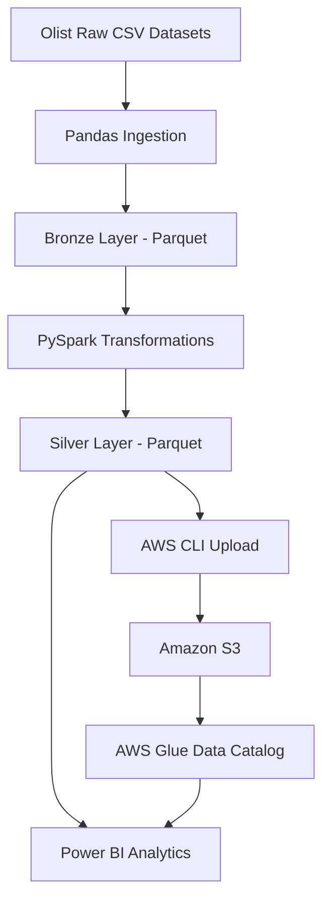

# RetailPulse — Brazilian E-Commerce Analytics

RetailPulse is an end-to-end e-commerce analytics project built around the Brazilian Olist marketplace dataset. It combines Python-based data ingestion, PySpark transformations, AWS storage and catalog services, and an interactive Power BI dashboard to explore business performance, customer behavior, payments, sellers, products, and regional trends.

## Project Overview

RetailPulse transforms raw e-commerce data into structured datasets for analytical reporting.

**Key objectives**
- Ingest raw CSV datasets and convert them into Parquet format.
- Build Bronze and Silver data layers.
- Apply data cleaning, standardization, and validation using PySpark.
- Store processed Silver datasets in Amazon S3.
- Register external datasets in the AWS Glue Data Catalog.
- Analyze business performance through an interactive Power BI dashboard.

## Architecture



**Important:** Data ingestion and transformations run locally using Python and PySpark. Silver Parquet files are uploaded to Amazon S3 separately using the AWS CLI. The Glue registration script creates catalog tables pointing to the S3 locations; it does not upload data or execute Glue transformation jobs.

## Technology Stack

| Category | Technologies |
|---|---|
| Programming | Python |
| Data ingestion | Pandas |
| Data processing | Apache Spark / PySpark |
| Storage format | Apache Parquet |
| Cloud storage | Amazon S3 |
| Data catalog | AWS Glue Data Catalog |
| AWS integration | Boto3, AWS CLI |
| Visualization | Microsoft Power BI |
| Version control | Git and GitHub |

## Dashboard

The Power BI report contains five analytical pages:

1. **Executive Overview** — High-level business KPIs and overall marketplace performance.
2. **Operations & Customer Insights** — Order operations and customer-related trends.
3. **Payment Analytics** — Payment methods and payment-related patterns.
4. **Seller Performance** — Seller-level performance analysis.
5. **Product & Regional Analytics** — Product category and geographical performance.

Dashboard file: `docs/RetailPulse_Dashboard.pbix`

## Repository Structure

```text
RetailPulse/
│
├── config/
│   └── glue-database.json
│
├── docs/
│   └── RetailPulse_Dashboard.pbix
│
├── src/
│   ├── ingestion/
│   │   ├── ingest_local.py
│   │   └── register_glue_tables.py
│   │
│   ├── quality/
│   │   ├── analyze_silver_exceptions.py
│   │   ├── check_geolocation_conflicts.py
│   │   ├── check_review_duplicates.py
│   │   ├── profile_bronze.py
│   │   ├── validate_bronze.py
│   │   └── validate_silver_integrity.py
│   │
│   └── transformations/
│       ├── transform_category_translation.py
│       ├── transform_customers.py
│       ├── transform_geolocation.py
│       ├── transform_orders.py
│       ├── transform_order_items.py
│       ├── transform_payments.py
│       ├── transform_products.py
│       ├── transform_reviews.py
│       └── transform_sellers.py
│
├── .gitignore
├── requirements.txt
└── README.md
```

The `data/` directory is excluded from Git to keep the repository lightweight. Raw and processed datasets must be obtained or generated locally.

## Getting Started

### 1. Clone the repository

```bash
git clone https://github.com/harshit180704/RetailPulse-PowerBI-Analytics.git
cd RetailPulse-PowerBI-Analytics
```

### 2. Create a virtual environment

```powershell
python -m venv .venv
.\.venv\Scripts\Activate.ps1
```

### 3. Install dependencies

```powershell
pip install -r requirements.txt
```

### 4. Prepare the datasets

Obtain the Brazilian E-Commerce Public Dataset by Olist and place its nine CSV files inside:

```text
data/
└── raw/
    ├── olist_customers_dataset.csv
    ├── olist_geolocation_dataset.csv
    ├── olist_orders_dataset.csv
    ├── olist_order_items_dataset.csv
    ├── olist_order_payments_dataset.csv
    ├── olist_order_reviews_dataset.csv
    ├── olist_products_dataset.csv
    ├── olist_sellers_dataset.csv
    └── product_category_name_translation.csv
```

### 5. Run local ingestion

From the project root:

```powershell
python src/ingestion/ingest_local.py
```

This reads the raw CSV files and generates Bronze Parquet datasets under:

```text
data/processed/bronze/
```

### 6. Run Silver transformations

Run the transformation scripts from the project root:

```powershell
python src/transformations/transform_customers.py
python src/transformations/transform_geolocation.py
python src/transformations/transform_orders.py
python src/transformations/transform_order_items.py
python src/transformations/transform_payments.py
python src/transformations/transform_products.py
python src/transformations/transform_reviews.py
python src/transformations/transform_sellers.py
python src/transformations/transform_category_translation.py
```

The scripts process Bronze datasets using local PySpark and write Silver Parquet outputs under:

```text
data/processed/silver/
```

### 7. Upload Silver datasets to Amazon S3

Configure the AWS CLI with credentials and a named profile called `retailpulse`.

For example:

```powershell
aws configure --profile retailpulse
```

Upload the Silver datasets to the configured S3 bucket. Replace the bucket name with your own:

```powershell
aws s3 cp .\data\processed\silver\ s3://YOUR_BUCKET_NAME/silver/ --recursive --profile retailpulse
```

The S3 directory structure should contain dataset folders such as:

```text
s3://YOUR_BUCKET_NAME/
└── silver/
    ├── customers/
    ├── geolocation/
    ├── orders/
    ├── order_items/
    ├── payments/
    ├── products/
    ├── reviews/
    ├── sellers/
    └── category_translation/
```

### 8. Register AWS Glue tables

Configure the AWS settings in `src/ingestion/register_glue_tables.py` to match your environment, including the S3 bucket, AWS region, and named profile.

Then execute:

```powershell
python src/ingestion/register_glue_tables.py
```

This registers external tables in the AWS Glue Data Catalog using the existing Silver dataset schemas and S3 locations.

**Prerequisites:** The Silver Parquet data must already exist at the expected S3 locations, and the configured AWS identity must have the required Glue permissions.

### 9. Open the Power BI report

Open:

```text
docs/RetailPulse_Dashboard.pbix
```

Configure or refresh the report's data connections as required by your local environment.

## AWS Configuration

The Glue registration script currently uses:

- AWS Region: `ap-south-1`
- Glue Database: `retailpulse_catalog`
- AWS CLI/Boto3 profile: `retailpulse`

Update the script's configuration values before running it in another AWS environment.

Never commit AWS access keys, secret keys, passwords, or `.env` files to GitHub.

## Data Quality

The project includes scripts for data profiling and validation across the Bronze and Silver layers, including:

- Bronze dataset profiling and validation.
- Silver data integrity checks.
- Geolocation conflict analysis.
- Duplicate review analysis.
- Silver exception analysis.

These scripts support data quality assessment throughout the processing workflow.

## Dependencies

The Python dependencies are listed in `requirements.txt`:

- pandas
- PySpark
- Boto3
- PyArrow

## Future Enhancements

- Automate S3 uploads as part of the ingestion workflow.
- Introduce AWS Glue ETL jobs for cloud-native transformations.
- Develop a dedicated Gold layer for business-ready analytical datasets.
- Add automated pipeline orchestration and scheduling.
- Expand automated testing and data quality monitoring.

## Author

**Harshit**

GitHub: [@harshit180704](https://github.com/harshit180704)

---

*RetailPulse — Turning e-commerce data into actionable business insights.*